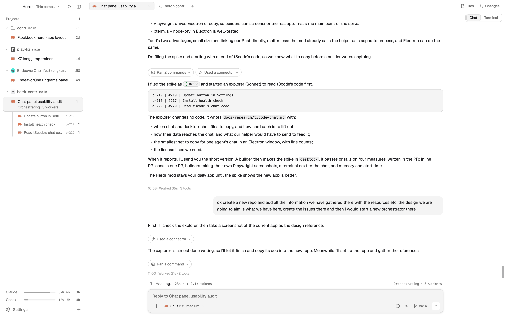

# The design to aim for

The target is herdr-contr as the owner uses it on 2026-11-16:

## Sources

| Source | What it holds |
|---|---|
| `herdr-contr-2026-11-16.png` | the screen as it is now. This wins when a text below disagrees |
| `recipe-herdr.md` | herdr-contr's RECIPE.md: each part in words, with sizes, colors and behavior. Some parts are older than the screenshot (the sidebar is now Herdr's own, reworked) |
| `chat-blocks.md` | what the chat must draw from an agent's Markdown: remarks, live chips, `contr-status`, `contr-queue`, `contr-flow`, `contr-seq` |
| Canvas: redesign | https://claude.ai/artifact/9bmbRdJc8qDMSRXm6obEb3 |
| Canvas: design system | https://claude.ai/artifact/45Kp6p9DoVg3iEMx9Qh7QH |
| Canvas: "Native · final" | https://claude.ai/artifact/LU6P91EHVmV8mWQp7qkZUN |

## The parts, left to right

1. **Sidebar** (about 340 px on the screenshot):
   - Head: the app name, the machine switch ("This computer"), search, and
     the sidebar toggle.
   - **Projects**, with a + on the right. One row per project: its icon (the
     repo's favicon, else a folder), its name and branch, and a count on the
     right. Under it, one row per agent: the agent icon (ours), its title and
     its age.
   - An orchestrator row is two lines: its title, then "Orchestrating · N
     workers". Its workers sit under it, indented behind a thin line: icon,
     title, the worker name (`b-219`) in mono, and a menu.
   - Foot: one usage row per plan (Claude, Codex): a meter, the percent and
     the window ("82% wk · 3h"). Then **Settings** and a +.
2. **Top bar**: Herdr's normal tab bar (its `tabs` mod). One tab per agent
   or terminal, from the left, 3 px apart, with a 1 px `border` line under
   the bar. A tab is 29 px tall, 7 px corners, 10 px side padding, 12.8 px
   text: its icon (14 px), its title (at most 170 px) and, on the shown tab
   only, a × (12 px, `dim`). The shown tab has the `raised` fill and a
   `border` edge; the others have no fill and `muted` text; hover is
   `hover`. The tab row scrolls sideways when it is full; after it, a + for
   a new tab (26 px square, 6 px corners). On the right: Files and Changes.
3. **Chat or Terminal**: a two-way switch at the top right of the work area.
4. **Chat**: a reading column, centered.
   - The owner's message: a right-aligned bubble, `raised` background.
   - The agent's text: Markdown. Lists, tables, code with a language label
     and Copy, inline code.
   - Live chips: `#229` with a state dot (open, merged, closed); worker names;
     file paths.
   - Tool calls fold into chips: "Ran 2 commands", "Used a connector", each
     with a chevron that opens it.
   - After each turn: the time, "Worked 35s · 3 tools".
   - `contr-status` and `contr-queue` blocks as a board and a queue (herdr-contr
     shows them as code today: herdr-contr #230).
5. **Status line** above the reply box: a spinner, the verb ("Hashing…"), the
   time and the tokens; on the right, "Orchestrating · 3 workers".
6. **Reply box**: "Reply to <title>". Under it: a + (attach), the model
   button (agent icon, "Opus 5.5", effort "medium", chevron), and on the right
   the context ring with its percent, the branch, and the send button.
7. **Cards** above the reply box when an agent asks for permission or asks a
   question: the choices as buttons, with keys.

## Colors

Light and dark, from theme tokens (`apps/desktop/src/renderer/index.css`). The
values are herdr-contr's themes: dark `herdr-app/themes/herdr-contr-mac.json`,
light `herdr-contr-mac-light.json` (`colors`, plus `foreground`). The terminal
takes `background`, `foreground`, `selection`, `cursor` and `ansi` from the same
files. The values in `recipe-herdr.md` are older; the theme files win.

- `chrome`: the sidebar and the top bar, and the fill of small controls
  (the Chat | Terminal switch, the tool-call chips). `canvas`: the work area.
  `raised`: the reply box, cards, menus, the owner's bubble.
- Agent icons: the program's own picture (Claude Code, Codex) in its own
  colors; Herdr's program table gives them `tint: false`. Another kind is a
  one-color glyph: in its state's color in the sidebar, `muted` in a tab.
- The loader: herdr-contr's braille frames, 80 ms each, in Menlo. In
  `working` on a tab, in a tool call and in a board; in `foreground` in the
  status line and on a sidebar row.
